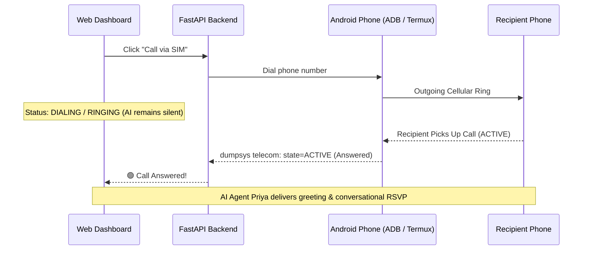

# Direct Audio Transfer & Cellular Calling Architecture

This guide explains how to stream AI-generated voice **directly** into a phone call and receive the caller's voice with **zero microphone involvement**, eliminating room noise and audio leakage.

---

## 1. Why Cellular Calling on Android Mutes or Bypasses Normal App Audio

In modern mobile operating systems (Android & iOS):
* **Circuit-Switched / VoLTE Cellular Calls** are handled directly by the **cellular baseband processor (modem DSP)**.
* The modem's hardware pipeline connects directly to the phone's physical microphone and earpiece (`STREAM_VOICE_CALL`).
* Android OS security intentionally isolates this cellular audio stream from user-space processes (including Termux, shell scripts, and web browsers) to prevent unauthorized call recording or injection without system-level signatures (`CAPTURE_AUDIO_OUTPUT`).
* When an app or script uses `am start -a android.intent.action.CALL` or `termux-telephony-call`:
  - The phone dials the cellular number.
  - However, media playback from Python or the browser outputs to the **loudspeaker** (`STREAM_MUSIC`), and the phone's physical microphone captures whatever room noise or audio bleeds through.

To transfer voice **directly into the call without using the phone's physical microphone**, you have two proven solutions:

---

## Solution A: Bluetooth Hands-Free (HFP/SCO) Virtual Audio (100% Free, Uses Phone SIM)

When an Android phone connects to a **Bluetooth Hands-Free Headset or Car Kit**, the Android OS automatically switches cellular audio routing from the internal microphone to the **Bluetooth SCO digital channel**.

By pairing your Android phone to your Windows PC or Linux machine as a Bluetooth Hands-Free Audio Gateway:
1. The PC acts as the "Hands-Free Headset" for the phone.
2. The incoming caller's voice is streamed digitally to the PC as an audio input (`Bluetooth Hands-Free Audio`).
3. The AI agent's synthesized voice is streamed digitally from the PC into the cellular call (`Bluetooth Hands-Free Audio`).
4. **The phone's physical microphone is 100% bypassed and muted.**

### Setup Steps for Windows PC + Android Phone:

1. **Pair via Bluetooth**:
   - On Android: Turn on Bluetooth.
   - On Windows: Go to **Settings > Bluetooth & devices > Add device > Bluetooth**.
   - Pair your Android phone with your PC.

2. **Enable Phone Audio Routing**:
   - On your Android phone, go to **Bluetooth Settings > Paired Devices > Your PC**.
   - Ensure the toggle **"Phone Calls"** (Hands-Free Profile / HFP) is **enabled**.

3. **Configure Browser / System Sound**:
   - In Windows **Sound Settings**:
     - **Default Communication Device (Input)**: Set to `Hands-Free Audio` (Android phone).
     - **Default Communication Device (Output)**: Set to `Hands-Free Audio` (Android phone).
   - In Chrome / Edge:
     - Open `chrome://settings/content/microphone` and select `Hands-Free Audio`.

4. **Run the Voice Agent**:
   - When you click **"Call via SIM"** on the dashboard, the phone dials through your SIM.
   - The recipient's voice travels: `Cellular Tower -> Phone -> Bluetooth SCO -> Web Speech STT`.
   - Priya's neural voice travels: `FastAPI TTS -> Bluetooth SCO -> Phone Modem -> Cellular Tower`.
   - **Zero microphone involvement.**

### Solution A.2: VB-Audio Virtual Cable + Microsoft Phone Link (Recommended on Windows 10/11)

If Windows pairs with your phone via **Microsoft Phone Link** instead of a raw Bluetooth audio driver:
1. **Install VB-CABLE**: Run `VBCABLE_Setup_x64.exe` as Administrator and reboot Windows.
2. **Configure Windows Communication Devices**:
   - Press the **"Windows Sound"** button on the dashboard (or run `mmsys.cpl`).
   - In the **Recording** tab: Right-click `CABLE Output (VB-Audio Virtual Cable)` -> **Set as Default Communication Device**.
3. **Configure Web Dashboard**:
   - In the dashboard, set **Audio Output (AI Voice)** to `CABLE Input (VB-Audio Virtual Cable)`.
4. **How It Works**:
   - Priya speaks -> browser outputs to `CABLE Input`.
   - VB-CABLE loops sound directly into `CABLE Output`.
   - Phone Link reads `CABLE Output` as its microphone, transmitting Priya's voice over Bluetooth into the phone call with zero background noise.
   - Phone Link plays the caller's voice through your PC speakers, where Chrome's STT transcribes the caller's responses in real-time.

---

## Solution B: Digital Telephony (Twilio / Plivo) with Verified Personal Caller ID

This is the architecture used by production AI calling platforms like **Sarvam AI**, **Retell**, and **Vapi**.

Instead of routing through a smartphone's hardware baseband:
1. The backend connects directly to a telecom carrier over a **digital SIP / WebSocket audio stream**.
2. **Twilio gives $15.00 in free trial credits** upon signing up (sufficient for hundreds of test calls).
3. **Your Own Phone Number as Caller ID**:
   - In the Twilio Console under **Phone Numbers > Verified Caller IDs**, you can register your personal mobile number via an instant SMS or phone verification code.
   - When the AI initiates an outbound call, **your personal mobile number appears on the recipient's phone screen**.
4. **Benefits**:
   - **100% Studio Digital Voice**: Raw 8kHz / 16kHz audio packets (G.711 / Opus) transferred over WebSockets.
   - **No Physical Hardware Needed**: No phone, no Termux, no Bluetooth pairing.
   - **Instant Answer Detection**: Carrier signals when the call is picked up (`in-progress`), when it's ringing, or if it hit voicemail (Answering Machine Detection).

### Twilio Integration Config:

To enable Twilio digital calling in `app/config.py`:
```env
TWILIO_ACCOUNT_SID=ACxxxxxxxxxxxxxxxxxxxxxxxxxxxxx
TWILIO_AUTH_TOKEN=your_twilio_auth_token
TWILIO_VERIFIED_CALLER_ID=+919876543210
```

---

## Solution C: Physical TRRS Audio Loopback / USB-C Audio Interface

If you are running the system in an embedded lab or kiosk with an Android phone:
1. Connect a standard **3.5mm TRRS (or USB-C) Audio Splitter** into the phone's headphone jack.
2. Connect the PC's Line-Out to the phone's Mic-In (via an attenuator / resistor divider to match mic levels).
3. Connect the phone's Line-Out to the PC's Mic-In.
4. Android detects an external headset and disables the internal microphone completely.

---

## Call Pick-Up Detection (Answer Confirmation)

The agent now includes real-time telecom connection detection using `dumpsys telecom` and `dumpsys telephony.registry`:



1. When **"Call via SIM"** is clicked, the call enters the `dialing` / `ringing` state.
2. The AI **remains completely silent** while the phone is dialing or ringing.
3. Once the recipient answers (`dumpsys telecom` reports `ACTIVE`), the AI voice stream automatically connects and delivers the event greeting.
4. If the call is declined, busy, or unpicked, the session resets cleanly to `idle` without playing speech into thin air.
